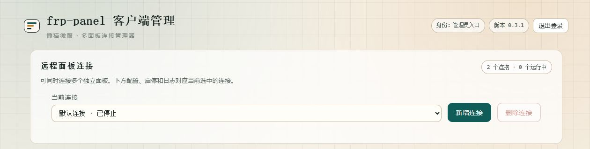

# frp-panel 客户端管理

基于 [frp-panel](https://github.com/VaalaCat/frp-panel) 的懒猫微服客户端，用于连接自建的远端 Master 和 Server，将微服或局域网中的服务通过 FRP 暴露出去。

提供中文管理界面，支持同时连接多个独立的 frp-panel 面板（最多 32 个连接）。每个连接分别保存名称、客户端身份和密钥，独立启动、停止、重启、自动启动，并分别显示运行状态、Master 可达性和脱敏日志。配置持久保存，客户端支持后台运行。

使用前，在远端 Master 创建客户端节点，复制启动命令，粘贴到本应用并点击“解析、保存并启动”。

安装包可从 [GitHub Releases](https://github.com/fanhuadesenlinnn/lazycat-frp-panel-client/releases) 下载。Intel/AMD 设备选择文件名带 `amd64` 的 `.lpk`，ARM 设备选择 `arm64`。安装包引用对应架构的懒猫仓库镜像，不需要通过应用商店安装。

连接第二个面板时，点击页面顶部的“新增连接”，填写连接名称，再粘贴该面板生成的启动命令。切换顶部的连接选择框即可管理对应连接；已启动的其它连接会继续在后台运行。同一应用 ID 内升级时，已有配置保留为“默认连接”；默认连接不能删除，可停止或修改配置。

每个新增连接使用独立的数据和 Worker 工作目录，删除连接会停止对应进程并移除其连接配置。配置只在当前连接内生效。客户端使用 Host 网络，127.0.0.1 指懒猫微服宿主机。各连接共享宿主机网络；各面板下发的 FRP 访客、Worker 或 WireGuard 配置需要使用不同的本地监听端口及接口名称。

管理页面运行在应用容器内，通过私有 Unix Socket 连接 Host 网络后台服务。后台管理接口不监听宿主机 TCP 端口；配置继续保存在原有的 `/lzcapp/var/frp-panel-client`。

应用 ID 为 `cloud.lazycat.app.frppcsm`，入口子域名为 `frppcsm`。从 0.3.0 及以前的旧 ID 安装包切换时，系统会安装为一个新应用，旧应用不会被覆盖，配置需重新录入或自行迁移。

## 界面介绍

上方可选择、添加或删除远程面板连接，并显示当前连接的客户端运行状态和 Master 可达性；下方可填写连接参数，或粘贴远端面板生成的启动命令。

## 构建测试版本

手动运行 GitHub Actions 的 `Prepare GitHub test release` 流程，会完成测试、双架构镜像构建、推送 GHCR、转存懒猫镜像仓库，以及生成并校验两种架构的 `.lpk`。产物中包含镜像引用、架构信息、源码归档和 SHA256 校验值。此流程不提交应用商店审核，也不更新 GHCR 的 `latest` 标签。验证产物后，将安装包上传至 GitHub Release 即可供手动安装测试。

## 0.3.2 连接可靠性更新

- 内置客户端固定到 `fanhuadesenlinnn/frp-panel` 的可靠性修复提交。后续构建使用自有仓库，不再从原仓库拉取旧代码。
- 管理界面分别显示进程状态、实际 RPC 注册状态、运行中的 FRP 隧道数。状态文件超过 20 秒或 PID 不匹配时会提示过期，不把旧进程的状态显示为在线。
- 隧道运行状态不能代替后端服务的 HTTP / 视频播放验证；Master 网络探针也不能代替 RPC 注册状态。
- 状态文件位于各连接工作目录，原子写入且权限为 0600，不包含连接密钥。已有连接配置会保留。容器重建后是否启动仍由各连接的自动启动选项控制。
